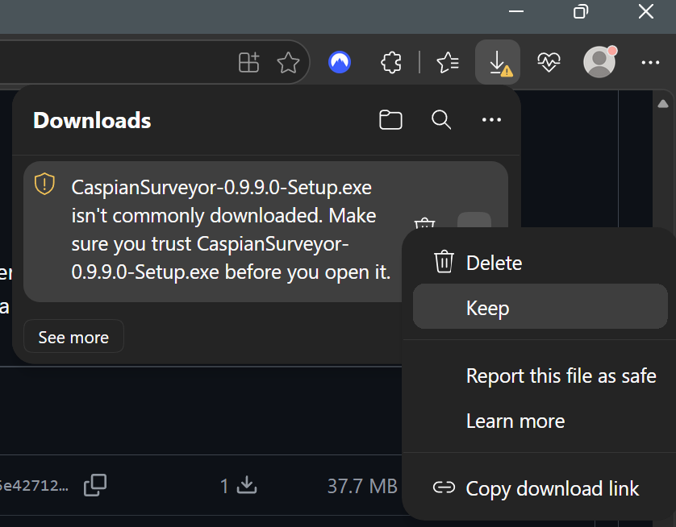
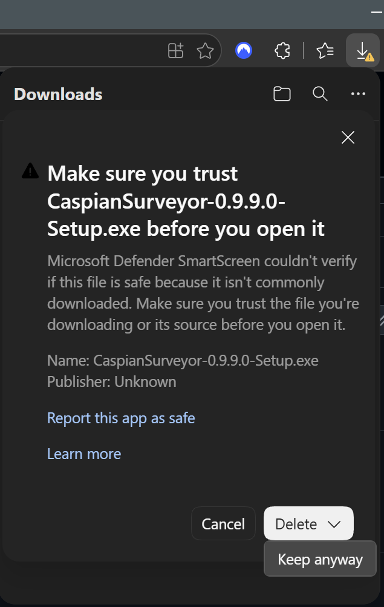

# Installation of Caspian Surveyor

## Running the Installer

1. Download `CaspianSurveyor-0.9.9.0-Setup.exe` from the GitHub Releases page.

2. Because the installer is currently unsigned, Microsoft Edge or another browser may warn that the file is not commonly downloaded. Keep the file **only if you downloaded it from the official Caspian Surveyor GitHub release page**.

   In Microsoft Edge:
   - Open the download menu and choose **Keep**.
   - When prompted to confirm, choose **Keep anyway**.

 

3. Run the installer. Administrator privileges are not required.

4. Windows may display an **Unknown Publisher** or **Microsoft Defender SmartScreen** warning when the installer is launched.

   If Windows displays **Windows protected your PC**, select **More info** → **Run anyway** if you trust the file source.

## Portable (.zip) Installation

1. Download `CaspianSurveyor-0.9.9.0-Windows.zip` from the GitHub Releases page.
2. Unzip the contents to your preferred directory.

***Note:*** Caspian Surveyor will still keep the default location for the application data directory (%LOCALAPPDATA%/CaspianSurveyor) regardless of where the files are unzipped.

## Upgrading a Portable (.zip) Installation
### General Upgrade Instructions - Database Recreation *not* Required

1. Download the `CaspianSurveyor-#.#.#.#-Windows.zip` file
2. Unzip the contents to the desired directory

If the SQLite database schema is updated, the database will need to be recreated to ensure Caspian Surveyor functions properly.

With the ongoing development of Caspian Surveyor, there may be a need to recreate the SQLite database. The installer handles this, but the process for a portable installation requires specific steps.

***Please note that if the database needs to be recreated, the release notes will state so.***
***These steps are generalized. A release may require specific steps to be performed. Please refer to the release notes section and ensure to follow the correct upgrade procedure.***

### General Upgrade Instructions - Database Recreation Required

***IMPORTANT***: Replace `<UPGRADE_VERSION>` with the version requiring the database recreation, without the angle brackets. For version 0.9.9.0, use 0990.

1. Navigate to `%LOCALAPPDATA%\CaspianSurveyor\data`
2. Locate `historical_event_ingestion.ini`
3. Right-click -> Open with your preferred text editor
4. Update `historical_event_ingestion = False` -> `historical_event_ingestion = True` then save your changes
5. Back in `%LOCALAPPDATA%\CaspianSurveyor\data`, locate `exploration_history.jsonl`
6. Right-click -> Rename to `exploration_history_PRE-<UPGRADE_VERSION>.jsonl`
7. Back in `%LOCALAPPDATA%\CaspianSurveyor\data`, navigate to the `db` directory
8. Right-click `caspian_surveyor.db` -> Rename to `caspian_surveyor_PRE-<UPGRADE_VERSION>.bak`
9. Launch Caspian Surveyor