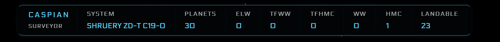
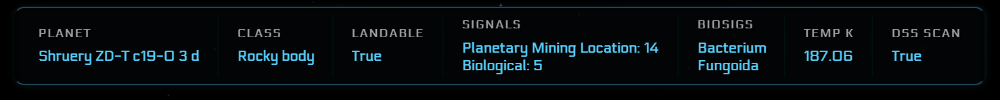
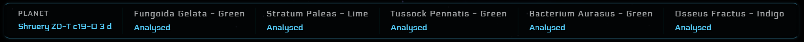
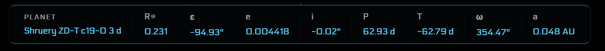
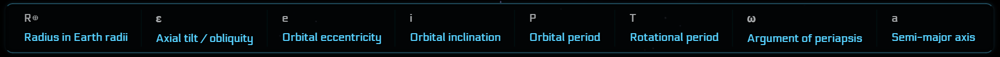

# Caspian Surveyor - Exploration Overlay

Annotated Positions:
- [0, 0] - default panel
- [1, 0] - from default panel, cycle right once
- [1, 1] - from default panel, cycle right once, cycle down once
- [1, 2] - from default panel, cycle right once, cycle down twice

---
---

## Default (Home) Panel - [0, 0]

HOTKEY: `Ctrl + Alt + HOME`

The default system panel contains:
- System name
- Celestial body count
- Earthlike world body count
- Terraformable water-world body count
- Terraformable high-metal content body count
- Water-world body count
- High-metal content body count
- Landable body count

---
---

## Celestial Body Panel - [1, 0]

HOTKEYS:
    - `Ctrl + Alt + RIGHT` - cycle right
    - `Ctrl + Alt + LEFT` - cycle left

The celestial body panel contains:
- Body name
- Body class
- Landable (True or False)
- Signals (geological, biological, mining)
- Biological signals
  - Displays two at a time. If there are greater than two signatures, the panel cycles to the next group every five seconds
- Surface Temperature in kelvin
- DSS scan completed

You can cycle right or left as much as you'd like; if you cycle right ten times on a nine body system, the tenth cycle will place you back at the first celestial body

---
---

## Exobiology Panel - [1, 1]

HOTKEYS: From the celestial body panel
- `Ctrl + Alt + DOWN`: cycle down
- `Ctrl + Alt + UP`: cycle up

Note: the cycle up/down hotkeys will act similarly to the cycle left/right hotkeys. There are three vertical panels. Cycling up three times will place you in the same panel.

The exobiology panel contains:
- Celestial body name
- Variant localised
- Scan status
  - First exobio scan: 1 Sample
  - Second exobio scan: 2 Samples
  - Third exobio scan: Analysed

---
---

## Physical/Orbital Panel - [1, 2]

HOTKEYS: From the celestial body panel
- `Ctrl + Alt + DOWN`: cycle down
- `Ctrl + Alt + UP`: cycle up

The physical/orbital panel contains:
- Radius: **R⊕**
- Axial tilt: **ε**
- Orbital eccentricity: **e**
- Orbital inclination: **i**
- Orbital period: **P**
- Rotational period: **T**
- Argument of periapsis: **ω**
- Semi-major axis: **a**

---
---

## Physical/Orbital Legend Panel Toggle

HOTKEY: `Ctrl + Alt + ]` (toggle from anywhere)

The physical/orbital legend contains:
- **R⊕** - Radius in Earth radii
- **ε** - Axial tilt/obliquity
- **e** - Orbital eccentricity
- **i** - Orbital inclination
- **P** - Orbital period
- **T** - Rotational period
- **ω** - Argument of periapsis
- **a** - emi-major axis

---
---