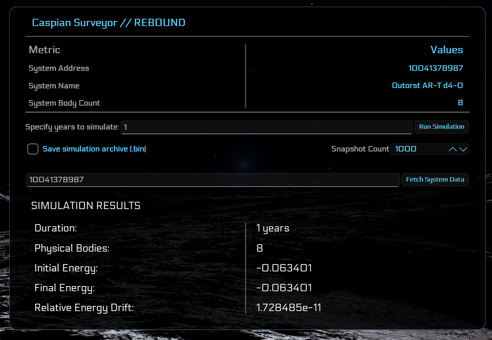

# Caspian Surveyor - REBOUND Simulations

## REBOUND Panel Toggle

HOTKEY: `Ctrl + Shift + R`

The REBOUND panel contains:
- System address
- System name
- System body count

To utilize the REBOUND simulation, you first must get the system address from Elite Dangerous.

*NOTE* - `caspian_surveyor.db` can be explored with third-party tools such as DB Browser.

1. Obtain a system address from a system that has been archived.
2. Enter the system address in the text box to the left of `Fetch System Data`
3. Click `Fetch System Data`.
4. The Metric/Value information will fill out with basic details of the system.
5. In the `Specify years to simulate:` text box, enter the number of years to simulate.
  - NOTE: Please begin at a low number such as `1` or `5`. REBOUND simulations can be resource-intensive.
6. Click `Run Simulation`.
  - If you wish to save the simulation, check the `Save simulation archive (.bin)` check box.
  - You can adjust the number of snapshots the simulation takes, allowing more *states* to be accessed when replaying the simulation.
7. When the REBOUND simulation completes, the panel will expand, displaying the following:
  - Duration
  - Physical bodies
  - Initial energy
  - Final energy
  - Relative energy drift
8. To exit the REBOUND panel, simply use the toggle hotkey (`Ctrl + Shift + R`) once more

NOTE: If you wish to move the REBOUND window, double-clicking *within* the panel will bring up the title bar, allowing you to drag and move, resize, minimize or simply exiting the REBOUND panel.

